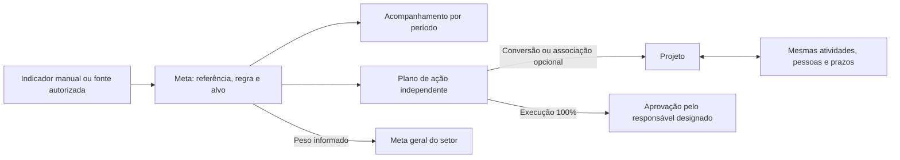

# Metas, planos de ação e projetos — validação em homologação

27/10/2026 · Grupo Consominas · Situação: validação local final aprovada; revisão remota e publicação em andamento.

## Resultado

A melhoria utiliza as abas **Metas** e **Planos de Ação** existentes dentro de Contratos. A pessoa define o resultado esperado e sua fonte, acompanha o indicador por competência, cria um plano independente e, se desejar, transforma esse plano em projeto. O projeto compartilha as atividades e responsáveis do plano. A conclusão da execução e sua aprovação aparecem na meta, sem substituir o resultado medido.

## Comportamento implementado

- As abas de Contratos concentram esse fluxo. A página existente de Metas gerais continua destinada às metas gerais do setor, sem receber uma nova navegação de planos.
- Meta com contexto opcional de contrato/CCU. Fonte financeira exige autorização própria para o módulo e o CCU; indicador manual aceita registros por competência e observação.
- Custo total ou conta do CCU, faturamento e medição usam a cópia sincronizada e as regras existentes do sistema. Seleção de contas e prévia da referência são consultas, sem gravar metas nem disparar sincronização do Senior.
- Regras de reduzir, aumentar, atingir um valor ou manter uma faixa. Alvo absoluto ou variação percentual para aumento/redução, validados no servidor. Base zero exige alvo absoluto para evitar percentual indefinido.
- Referência e acompanhamento separados. Frequência mensal, trimestral, semestral ou anual, com análise periódica ou acumulada. Indicador manual usa a última revisão da competência; fonte financeira soma os meses da janela correspondente.
- Meses abertos, futuros, incompletos ou sem cobertura não comprovam resultado final. Ausência de medição ou cobertura não equivale a zero. Custo respeita o piso de janeiro/2026; custo, medição e faturamento exigem sincronização posterior ao fechamento no fuso de São Paulo. Falha na leitura de notas deixa faturamento pendente.
- Preparar um plano não cria projeto e não exige acesso ao módulo Projetos. A pessoa pode manter apenas o plano, converter em projeto novo ou associar projeto existente que tenha permissão para gerenciar.
- A conversão incorpora ações existentes uma única vez. Depois dela, as atividades são as mesmas Tasks do projeto, com responsável, situação e prazo compartilhados. Alterações de prazo reutilizam as regras de cronograma e os hooks de calendário existentes.
- Enviar para aprovação exige pelo menos uma atividade e execução de 100%. Somente o responsável designado decide; autoaprovação é bloqueada. Mudanças posteriores no conteúdo do plano, projeto ou atividades exigem nova avaliação da aprovação.
- Execução e aprovação não fabricam o resultado do indicador. Uma redução de 10% sobre base 100, com resultado 95, permanece com avanço de 50% mesmo após concluir e aprovar todas as atividades.
- Meta pode contribuir para uma meta geral do setor com peso explícito. Peso 80% × resultado 50% = 40% da composição; os 20% restantes não são renormalizados. O servidor impede excesso de peso, dupla contagem e mistura com a composição legada. Resultado indisponível permanece pendente.
- Vínculo a projeto não concede acesso financeiro. Valores de referência, alvo, variação, tolerância, realizado e histórico são ocultados sem acesso à fonte. Gestor designado pode revisar o conteúdo da execução na caixa existente de Aprovações.
- Registros antigos continuam legíveis. Excluir uma atividade incorporada ao projeto não ressuscita a ação antiga. A configuração é auditada; após medições manuais, a regra estrutural permanece fixa, enquanto dados administrativos continuam editáveis.

## Evidências e validação final

| Verificação | Evidência disponível nesta revisão |
|---|---|
| Schema Prisma | Validado e aplicado a bancos locais fictícios |
| TypeScript e compilação Next.js | Compilação final concluída com sucesso em 27/10/2026 |
| Regressão financeira e domínio | 352 testes: 351 aprovados, zero falhas e um gabarito SOAP já ignorado |
| Aprovação após mudanças de conteúdo | Três testes de assinatura incluídos na regressão final |
| HTTP de metas e planos com NextAuth/PostgreSQL | 14 grupos aprovados na versão compilada |
| HTTP de composição do setor | Sete grupos aprovados na versão compilada |
| Compatibilidade HTTP de Contratos | 11 cenários aprovados na versão compilada |
| Navegador real sem janela | Fluxo pelas abas de Contratos, plano sem projeto, conversão opcional, resultado mensal, peso80×50=40, aprovação pela caixa existente e reabertura com reavaliação; zero erros de página |
| Escritas reais | Nenhum cadastro real criado até esta revisão; testes usam dados fictícios e limpeza ao terminar |

O roteiro visual utiliza base fictícia de 100 horas, redução de 10%, alvo 90 e resultado de setembro de 95 horas. A execução de 100% e a aprovação não alteram o avanço medido de 50%; com peso de 80%, a contribuição para o setor é 40%. Reabrir uma atividade exige reavaliar a aprovação.

Evidências locais: `.qa/build.log`, `.qa/regressao-financeiro.log`, `.qa/contratos-compatibilidade.log`, `.qa/ui-contract-result.json` e os logs das suítes HTTP. Esses arquivos não integram os cadastros do sistema. A rodada final local foi aprovada. Os checks remotos são verificados separadamente antes da implantação.

## Publicação e exemplo solicitado

- O usuário autorizou expressamente o uso da credencial GitHub salva para revisão no repositório `joaomurilo1307-debug/APPCNS`. A pendência anterior dessa autorização está resolvida. Credenciais e evidências privadas não integram o código ou pacote de revisão.
- Até esta revisão, a versão ainda não foi publicada e nenhum exemplo foi cadastrado. A publicação depende da validação final, checks remotos da revisão e backup/recuperação conferidos.
- Após a publicação, foi autorizado criar no administrador um exemplo identificado no **CCU 19 — Desenvolvimento e Inovação**: reduzir o custo mensal em **10% em um ano**, com fonte automática, plano, projeto e atividades para **João Oliveira**. Atividades devem permanecer abertas e nenhuma aprovação ou economia será simulada.
- A análise automática reflete os dados sincronizados disponíveis. O histórico financeiro não é um snapshot contábil imutável; atualizações da origem podem alterar os valores consultados.
- Os hooks de Outlook foram reaproveitados, sem conta real conectada nos testes. Não houve teste de carga geral; os testes concorrentes cobrem a criação e associação de planos e a integridade dos vínculos.
- O backup integral do Scoreplan é uma pendência separada e não autoriza desligá-lo.

## Prévia com dados fictícios

